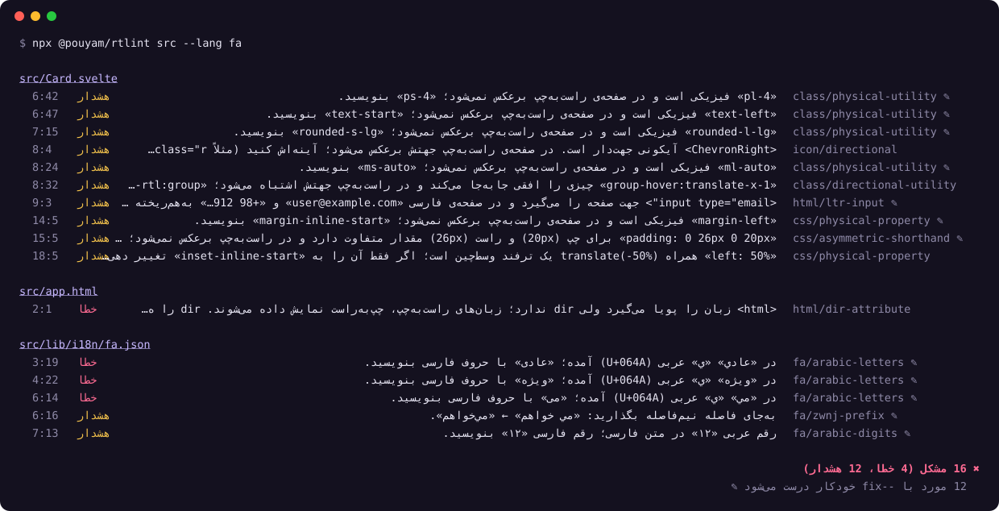

<div dir="rtl">

<div align="center">

# rtlint

**باگ‌های راست‌به‌چپ و اشتباه‌های نگارش فارسی را در کد پیدا می‌کند و بیشترشان را خودش درست می‌کند.**

[](https://github.com/pouyamsmartcity/rtlint/actions/workflows/ci.yml)
[](LICENSE)

[](https://www.pouyam.com)

**[امتحان آنلاین (بدون نصب)](https://pouyamsmartcity.github.io/rtlint/playground/)** · [راهنمای همه‌ی قانون‌ها](docs/rules.fa.md) · [English](README.md)

</div>

<p align="center"></p>

---

## این ابزار به چه درد می‌خورد؟

اگر سایت یا اپی دارید که فارسی هم دارد، احتمالاً این‌ها را دیده‌اید:

- عکس پروفایل به متن چسبیده و فاصله سمت اشتباه افتاده است.
- فلش «بعدی» به عقب اشاره می‌کند.
- ایمیل یا شماره‌ی تلفن در فیلد فرم به‌هم ریخته نمایش داده می‌شود.
- کاربر «کتاب» را جست‌وجو می‌کند ولی چیزی پیدا نمی‌شود، چون در متن با «ك» عربی نوشته شده است.
- متنی که از PDF کپی شده درست دیده می‌شود، ولی جست‌وجو و صفحه‌خوان پیدایش نمی‌کنند.

همه‌ی این‌ها با یک خط درست می‌شوند، ولی چون معمولاً کسی کد را در حالت راست‌به‌چپ امتحان نمی‌کند، دیده نمی‌شوند. **rtlint کد را می‌خواند، این مشکل‌ها را با توضیح فارسی نشان می‌دهد و با یک دستور درستشان می‌کند.**

### یک مثال ساده

فرض کنید طراح برای کارت زیر نوشته است `margin-right: 12px` تا بین عکس و متن فاصله بیفتد. در صفحه‌ی انگلیسی درست است، ولی در صفحه‌ی فارسی عکس سمت راست می‌آید و آن فاصله به بیرون کارت می‌رود؛ عکس به متن می‌چسبد.

rtlint آن را به `margin-inline-end: 12px` تبدیل می‌کند. این «ویژگی منطقی» یعنی «فاصله در انتهای جهت متن»؛ در انگلیسی سمت راست است و در فارسی سمت چپ. **یک CSS، برای هر دو زبان درست.**

در [صفحه‌ی امتحان آنلاین](https://pouyamsmartcity.github.io/rtlint/playground/) همین مثال را قبل و بعد از اصلاح کنار هم می‌بینید.

---

## سه دقیقه تا اولین نتیجه

**۱. Node.js را نصب کنید** (نسخه‌ی ۲۰ یا بالاتر) از [nodejs.org](https://nodejs.org). اگر نصب است، از این مرحله رد شوید.

**۲. در پوشه‌ی پروژه‌تان این دستور را بزنید:**

<div dir="ltr">

```bash
npx github:pouyamsmartcity/rtlint --lang fa
```

</div>

چیزی نصب نمی‌شود و هیچ فایلی تغییر نمی‌کند؛ فقط گزارش می‌دهد. `--lang fa` پیام‌ها را فارسی می‌کند.

**۳. گزارش را بخوانید.** هر خط یعنی یک مشکل: شماره‌ی خط و ستون، «خطا» یا «هشدار»، توضیح فارسی، و نام قانون. علامت ✎ یعنی خودکار درست می‌شود.

**۴. اصلاح خودکار:**

<div dir="ltr">

```bash
npx github:pouyamsmartcity/rtlint --lang fa --fix
```

</div>

فقط اصلاح‌هایی انجام می‌شوند که با اطمینان امن‌اند. اگر پروژه در git است، با `git diff` می‌توانید همه‌ی تغییرها را ببینید و اگر چیزی را نخواستید برگردانید.

> فقط یک فایل یا پوشه را بررسی کنید: `npx github:pouyamsmartcity/rtlint src/components --lang fa`

---

## چه چیزهایی را پیدا می‌کند؟

### ۱. چیدمانی که در فارسی برعکس نمی‌شود

| مشکل | مثال | rtlint |
| --- | --- | --- |
| ویژگی‌های فیزیکی CSS | `margin-left`، `padding-right`، `left`، `text-align: left` | به نسخه‌ی منطقی تبدیل می‌کند ✎ |
| مقدارهای نامتقارن | `padding: 0 26px 0 20px`، `border-radius: 8px 0 0 8px` | به `padding-inline` و گوشه‌های منطقی تبدیل می‌کند ✎ |
| کلاس‌های Tailwind و Bootstrap | `ml-4`، `pr-2`، `text-right`، `border-l-2`، `rounded-tr-lg` | به `ms-4`، `pe-2`، `text-end` و … تبدیل می‌کند ✎ |
| استایل React و React Native | `marginLeft`، `textAlign: 'left'` | به `marginInlineStart` (یا `marginStart` در React Native) تبدیل می‌کند ✎ |
| حرکت افقی | `translate-x-1`، `origin-left` | می‌گوید نسخه‌ی `rtl:` لازم است |
| آیکون‌های جلو و عقب | `<ChevronRight>`، `fa-arrow-right`، `arrow_forward` | می‌گوید باید آینه شوند |

### ۲. جهت صفحه و فرم‌ها

- `<html lang="fa">` بدون `dir="rtl"` ✎
- `lang` پویا (مثلاً در Next.js یا SvelteKit) بدون `dir`
- فیلد ایمیل، آدرس اینترنتی و تلفن بدون `dir="ltr"` ✎

### ۳. نگارش فارسی

| اشتباه | درست |
| --- | --- |
| `ي` و `ك` عربی | «ی» و «ک» فارسی ✎ |
| `می روم`، `میروم` | می‌روم ✎ |
| `کتاب ها`، `بزرگ تر` | کتاب‌ها، بزرگ‌تر ✎ |
| `خانه ای`، `رفته اند`، `خانه ی من` | خانه‌ای، رفته‌اند، خانه‌ی من ✎ |
| رقم عربی `١٤٠٣` یا قاطی `۱۲3` | ۱۴۰۳، ۱۲۳ ✎ |
| `,` و `?` و `;` لاتین | «،» و «؟» و «؛» ✎ |
| فاصله قبل از علامت یا داخل گیومه | بدون فاصله ✎ |
| کشیده (ـ) | حذف ✎ |
| حروف کپی‌شده از PDF | حروف معمولی ✎ |

### ۴. امنیت

نویسه‌های نامرئی کنترل جهت که می‌توانند کد را طوری نشان دهند که با اجرای واقعی‌اش فرق کند. این حمله‌ی [Trojan Source](https://trojansource.codes/) است و rtlint جلویش را می‌گیرد.

---

## به چه چیزهایی دست نمی‌زند؟

یک ابزار خوب باید بداند کجا **نباید** دخالت کند. rtlint این‌ها را عمداً رها می‌کند:

- **کدی که از قبل برای فارسی نوشته شده:** مثل `[dir="rtl"] .x { margin-right: 8px }` یا `isRtl ? 'mr-2' : 'ml-2'`.
- **ترفند وسط‌چین:** `left: 50%` همراه `translate(-50%)`. تغییر نیمی از آن خرابش می‌کند، پس فقط هشدار می‌دهد.
- **حاشیه‌ی امن ناچ گوشی:** `env(safe-area-inset-left)` که به خود گوشی بسته است، نه به جهت متن.
- **متن عربی:** فایل `ar.json`، نقل‌قول عربی داخل متن فارسی، و آیه‌های قرآن.
- **داده و کد:** فایل CSV، فهرست‌های YAML، لینک‌ها، کد داخل Markdown، و جدول‌های تبدیل حروف در کد.
- **«تر» به معنی خیس:** `میوه تر` را به «میوه‌تر» تبدیل نمی‌کند.
- **کلمه‌هایی که با «می» شروع می‌شوند ولی فعل نیستند:** «میز»، «میدان»، «میوه».

روی نیم مگابایت ترجمه‌ی فارسی سایت پویام و ترجمه‌های عربی کنارش، هیچ گزارش اشتباهی نمی‌دهد.

---

## استفاده در پروژه

### تنظیمات

یک فایل `rtlint.config.json` در ریشه‌ی پروژه بسازید (اختیاری است):

<div dir="ltr">

```json
{
  "$schema": "https://raw.githubusercontent.com/pouyamsmartcity/rtlint/main/schema/config.json",
  "lang": "fa",
  "rules": {
    "fa/*": "error",
    "class/directional-utility": "off"
  },
  "ignore": ["legacy/**"]
}
```

</div>

با `"lang": "fa"` همیشه پیام‌ها فارسی است. `$schema` باعث می‌شود ویرایشگر همه‌ی گزینه‌ها را پیشنهاد بدهد.

### خاموش کردن در یک خط

اگر جایی عمداً چپ‌به‌راست است (مثلاً نمودار یا اسلایدر):

<div dir="ltr">

```js
// rtlint-disable-next-line class/physical-utility -- این اسلایدر همیشه چپ‌به‌راست است
```

</div>

### ESLint و Stylelint

<div dir="ltr">

```js
// eslint.config.js
import rtlint from 'rtlint/eslint';

export default [
  rtlint.configs.recommended,
  { settings: { rtlint: { lang: 'fa' } } },
];
```

</div>

این‌طوری مشکل‌ها با پیام فارسی مستقیم در VS Code و هر ویرایشگری که ESLint دارد نشان داده می‌شوند. افزونه‌ی Stylelint هم دارد: `plugins: ['rtlint/stylelint']`.

### GitHub Actions

<div dir="ltr">

```yaml
- uses: actions/checkout@v4
- uses: pouyamsmartcity/rtlint@main
  with:
    paths: src
    args: --lang fa
```

</div>

مشکل‌ها با پیام فارسی روی همان خط‌های تغییرکرده‌ی Pull Request نمایش داده می‌شوند.

---

## سؤال‌های رایج

**کدم جایی فرستاده می‌شود؟**
نه. rtlint روی کامپیوتر خودتان اجرا می‌شود و صفحه‌ی امتحان آنلاین هم کاملاً در مرورگر خودتان کار می‌کند.

**نسخه‌ی انگلیسی سایتم خراب نمی‌شود؟**
نه. ویژگی‌های منطقی در صفحه‌ی چپ‌به‌راست دقیقاً مثل قبل رفتار می‌کنند. اصلاح‌ها طوری طراحی شده‌اند که ظاهر انگلیسی هیچ تغییری نکند.

**با کدام فریم‌ورک‌ها کار می‌کند؟**
CSS، SCSS و Less، Tailwind، UnoCSS و Bootstrap، React و Next.js، React Native، Vue، Svelte و SvelteKit، Astro و HTML. متن فارسی را در Markdown، JSON و YAML ترجمه‌ها، Dart و Flutter، Python و زیرنویس‌ها (`srt` و `vtt`) هم بررسی می‌کند.

**اگر چیزی را اشتباه گرفت چه کنم؟**
با یک توضیح `rtlint-disable` آن خط را رد کنید و لطفاً [یک issue باز کنید](https://github.com/pouyamsmartcity/rtlint/issues/new/choose). گزارش‌های اشتباه مهم‌ترین چیزی است که به بهتر شدن ابزار کمک می‌کند.

**ترمینال من فارسی را به‌هم‌ریخته نشان می‌دهد.**
بعضی ترمینال‌ها متن راست‌به‌چپ را درست نمایش نمی‌دهند. در این حالت پیام‌های فارسی را در VS Code (با افزونه‌ی ESLint)، در Pull Request گیت‌هاب، یا در صفحه‌ی امتحان آنلاین ببینید. یا در ترمینال `--lang fa` را نزنید.

---

## مشارکت

اگر فارسی، عربی، اردو یا عبری می‌دانید و اشتباه رایجی می‌بینید که rtlint نمی‌گیرد، خوشحال می‌شویم [خبرمان کنید](https://github.com/pouyamsmartcity/rtlint/issues/new/choose). راهنمای توسعه در [CONTRIBUTING.md](CONTRIBUTING.md) است.

## سازندگان

ساخته‌ی تیم [**پویام**](https://www.pouyam.com)، شبکه‌ی اجتماعی و بازی دوزبانه‌ی فارسی و انگلیسی. این ابزار را بعد از پیدا کردن همین باگ‌ها در کد خودمان ساختیم. بررسی کامل ۱۸۰۰ فایل کد پویام حدود دو ثانیه طول می‌کشد و فیلدهای ایمیل به‌هم‌ریخته، نام کشوری که با حروف کپی‌شده از PDF ذخیره شده بود، آیکون‌هایی که برعکس نمی‌شدند و صدها کلاس آینه‌نشده را پیدا کرد.

با [Claude Code](https://claude.com/claude-code) نوشته شده است.

**اگر rtlint یک باگ راست‌به‌چپ را برایتان پیدا کرد، با یک ⭐ کمک کنید بقیه‌ی برنامه‌نویس‌های فارسی‌زبان هم پیدایش کنند.**

مجوز MIT

</div>
