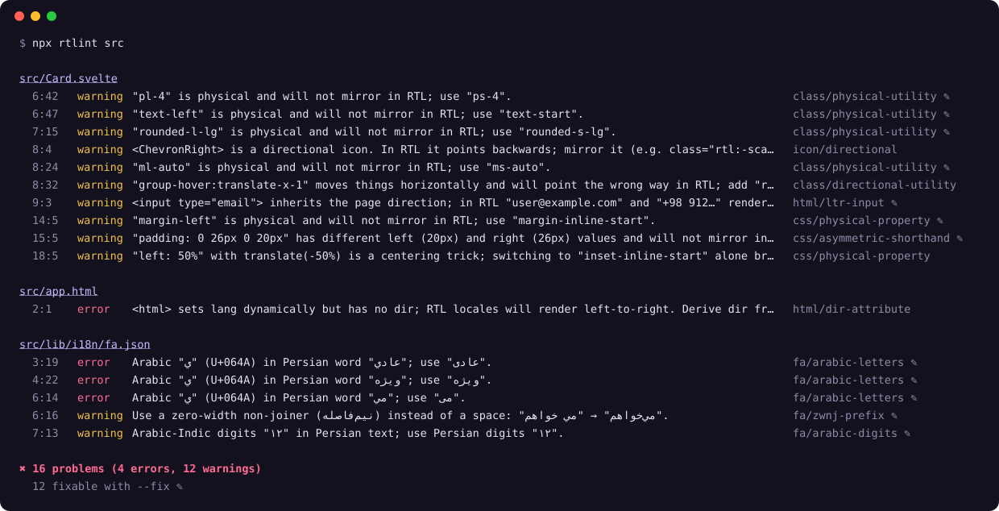

<!-- rtlint-disable-file fa/* text/* -->
<div align="center">

# rtlint — the RTL linter by Pouyam

**Find and fix right-to-left (RTL) bugs before your Persian, Arabic, Hebrew and Urdu users do.**

A zero-dependency linter for logical CSS, Tailwind/Bootstrap utilities, React and React Native styles,
HTML direction, back/next icons, Persian typography and Trojan Source bidi attacks, with safe `--fix`.
CLI, ESLint, Stylelint, Vite, GitHub Action, pre-commit and an MCP server for AI assistants.

[](https://www.npmjs.com/package/@pouyam/rtlint)
[](https://github.com/pouyamsmartcity/rtlint/actions/workflows/ci.yml)
[](LICENSE)

[](https://www.pouyam.com)

[Playground](https://pouyamsmartcity.github.io/rtlint/playground/) · [Rules](docs/rules.md) · [Guides](docs/guides) · [AI assistants](docs/ai.md) · **[راهنمای کامل فارسی](README.fa.md)**

</div>

---

More than 500 million people read right-to-left, and most interfaces still break for them in the
same small ways: a margin on the wrong side, an arrow that points backwards, an email address
whose `@` jumps to the end, a Persian word typed with Arabic letters that search can no longer find.
Each one is a one-line fix. Nobody catches them because nobody on the team reads RTL.

**rtlint catches them in CI and fixes most of them for you.**

<p align="center"></p>

<sub>Real output for [`examples/demo`](examples/demo), regenerated by `node scripts/render-demo.js`. With `--fix`, everything marked ✎ is repaired in place.</sub>

## Why another linter?

Tools for this already exist, but each one covers a single layer. A real RTL bug can sit in any of them:

| | rtlint | stylelint logical plugins | rtlcss | eslint-plugin-rtl-friendly |
| --- | :---: | :---: | :---: | :---: |
| CSS physical properties / values | ✅ | ✅ | flips at build time | |
| Asymmetric shorthands (`padding: 0 8px 0 4px`, `border-radius`) | ✅ fixes | | flips | |
| Tailwind / UnoCSS / Bootstrap classes, `clsx`, `cn`, `@apply` | ✅ | | | Tailwind only |
| React / React Native inline styles | ✅ | | | |
| `<html dir>`, LTR inputs (email, URL, phone) | ✅ | | | |
| Back/next icons that don't mirror (Lucide, Heroicons, Font Awesome, Material…) | ✅ | | | |
| Persian typography (ی/ک, half-space, digits, punctuation) | ✅ | | | |
| PDF copy-paste glyphs (Arabic presentation forms) | ✅ | | | |
| Trojan Source bidi controls (CVE-2021-42574) | ✅ | | | |
| Knows the centering trick and safe-area insets are *not* bugs | ✅ | | | |
| CLI, ESLint, Stylelint, Vite, GitHub Action, pre-commit, MCP for AI | ✅ | Stylelint | build step | ESLint |
| Messages and docs in Persian | ✅ | | | |
| One command, no config, no runtime dependencies | ✅ | | | |

<sub>Based on each project's own documentation when this was written. If we got yours wrong, please open an issue.</sub>

## Quick start

```bash
npx @pouyam/rtlint            # lint the current directory
npx @pouyam/rtlint src --fix  # apply safe fixes
```

Node.js 20 or newer. No install, no config and no runtime dependencies: the whole package
is plain JavaScript you can read in an afternoon.

To keep it in a project (needed for the ESLint, Stylelint and Vite plugins):

```bash
npm install --save-dev @pouyam/rtlint
npx @pouyam/rtlint
```

```bash
npx @pouyam/rtlint init        # detect the project and write rtlint.config.json
npx @pouyam/rtlint --changed   # only files changed since the last commit
npx @pouyam/rtlint explain fa/zwnj-suffix   # what a rule does, with examples
```

### Adopting it in a large codebase

```bash
npx @pouyam/rtlint --update-baseline        # record today's problems in rtlint-baseline.json
npx @pouyam/rtlint --baseline rtlint-baseline.json   # from now on, only new problems fail CI
npx @pouyam/rtlint --cache --staged         # fast pre-commit check of staged files
npx @pouyam/rtlint --fix-only fa/*          # fix one family of rules at a time
```

Baselines match problems by rule and line content, not line number, so editing other parts of a
file does not bring old problems back.

### ESLint

```js
// eslint.config.js
import rtlint from '@pouyam/rtlint/eslint';

export default [
  rtlint.configs.recommended,
  // or pick rules: { plugins: { rtlint }, rules: { 'rtlint/class-physical-utility': 'error' } }
];
```

Every rule is available as `rtlint/<category>-<name>`. Add `settings: { rtlint: { lang: 'fa' } }` for Persian messages. Fixes work with `eslint --fix`, and the
plugin reads the raw source, so it also covers `.vue`, `.svelte` and `.astro` files your
ESLint setup parses.

### Vite

```js
// vite.config.js
import rtlint from '@pouyam/rtlint/vite';
export default { plugins: [rtlint({ lang: 'fa', failOnError: true })] };
```

Problems appear in the dev-server terminal as you save; with `failOnError`, `vite build` fails on errors.

### AI assistants (MCP)

```bash
claude mcp add rtlint -- npx -y @pouyam/rtlint mcp
```

Claude, Cursor, VS Code and other MCP clients can then lint and fix RTL code themselves.
[docs/ai.md](docs/ai.md) has the config for each client, plus an AGENTS.md snippet, a Cursor rule
and a Claude Code skill.

### pre-commit

```yaml
# .pre-commit-config.yaml
- repo: https://github.com/pouyamsmartcity/rtlint
  rev: v0.3.0
  hooks:
    - id: rtlint        # or rtlint-fix
```

### Stylelint

```js
// stylelint.config.mjs
export default {
  plugins: ['@pouyam/rtlint/stylelint'],
  rules: { 'rtlint/css': true }, // or { rules: { 'css/physical-value': 'off' } }
};
```

### Persian messages

Every message and rule description is also available in Persian: `--lang fa` on the CLI, or
`"lang": "fa"` in the config (ESLint: `settings.rtlint.lang`). The [playground](https://pouyamsmartcity.github.io/rtlint/playground/)
opens in Persian, and there is a full [Persian guide](README.fa.md) and [rule reference](docs/rules.fa.md).

### Editor autocomplete

Add `"$schema": "https://raw.githubusercontent.com/pouyamsmartcity/rtlint/main/schema/config.json"` to
`rtlint.config.json` for completion and validation of every rule and option.

### GitHub Actions

Problems show up as annotations on the pull request diff, with a summary table on the run page:

```yaml
- uses: actions/checkout@v7
  with: { fetch-depth: 0 }
- uses: pouyamsmartcity/rtlint@v0
  with:
    paths: src
    changed-only: true   # only files changed in the pull request
    lang: fa             # Persian messages
    args: --max-warnings 0
```

For GitHub code scanning, add `sarif: rtlint.sarif` and upload it with
`github/codeql-action/upload-sarif`.

## What it checks

**Layout that does not mirror.** These rules make one stylesheet work in both directions:

- `margin-left` → `margin-inline-start`, `left` → `inset-inline-start`, `text-align: left` → `start`, `float: right` → `inline-end`.
- `padding: 0 26px 0 20px` → `padding-block: 0; padding-inline: 20px 26px`, and the same for `border-radius` corners. The LTR result stays identical.
- In Tailwind, UnoCSS and Bootstrap, `ml-4 md:pr-2 -left-1 text-right border-l-2 rounded-tr-lg` → `ms-4 md:pe-2 -start-1 text-end border-s-2 rounded-se-lg`. Variants, `!important`, negative and arbitrary values are kept. Bootstrap 4 → 5 names too.
- `translate-x-1` / `origin-left` without an `rtl:` counterpart.
- Back/next icons that keep pointing the same way: `<ChevronRight>`, `<ArrowLeftIcon>`, `fa-chevron-right`, `icon="lucide:arrow-right"`, Material `arrow_forward`.
- `transition: margin-left` that stops animating once the property becomes logical, `letter-spacing` that pulls Persian letters apart, and (opt-in) Tailwind 3 `space-x-*`.
- In React styles, `marginLeft` → `marginInlineStart`. In React Native it uses `marginStart`, `borderTopStartRadius` and the rest of its own names.

**Direction.**

- `<html lang="fa">` without `dir="rtl"`, a mismatched `dir`, and `lang={locale}` with no `dir` at all.
- `<input type="email|url|tel">` without `dir="ltr"`, `<html>` without `lang`, and (opt-in) text inputs and textareas without `dir="auto"`.

**Persian typography.** These mistakes come from Arabic keyboard layouts and copy-paste:

- `ي ك ى` → `ی ک`. Arabic lines and files are detected and left alone.
- Arabic-Indic and mixed digits → Persian digits.
- Half-space (ZWNJ): `می روم` and `میروم` → `می‌روم`, `کتاب ها` → `کتاب‌ها`, `خانه ای` → `خانه‌ای`, `خانه ی من` → `خانه‌ی من`. Doubled, misplaced, ZWJ and ZWSP half-spaces are fixed too. Glued prefixes are only touched for known verbs, so `میز` and `میدان` stay as they are.
- `,` `;` `?` → `،` `؛` `؟`, no space before punctuation or inside `« »`, one space after it, no double spaces, no kashida.
- `→` in Persian text points backwards (Persian reads right to left), so it becomes `←`.
- Opt-in: `٪`, the Persian decimal and thousands separators, Persian digits in sentences, «guillemets» and `…`.
- Invisible characters (zero-width spaces, word joiners, stray BOMs) that break search and comparison.
- PDF copy-paste glyphs: `ﻣﻘﺪﻭﻧﯿﻪ` → `مقدونیه`. These presentation forms look right but search can't find them. This rule helps Arabic and Urdu text too.

**Security.**

- Invisible bidi override, embedding and isolate characters that make code read differently
  than it runs ([Trojan Source](https://trojansource.codes/)).

It also knows what **not** to touch:

- `left: 50%` with `translate(-50%)` and `left-1/2 -translate-x-1/2` are centering tricks. Flipping only half of the pair would break them.
- `env(safe-area-inset-left)` follows the physical notch.
- Classes with an `rtl:` or `ltr:` variant are deliberate.
- `left-panel` is not a Tailwind class.
- `ar.json` is Arabic, not misspelled Persian.

See every rule, with examples, in [docs/rules.md](docs/rules.md).

## Speed

On Pouyam's own SvelteKit app (1,827 files) a full run takes about 2 seconds. `node scripts/bench.js`
generates 2,000 files (11.7 MB) where nearly every line has a problem, a worst case of 464,000
findings, and lints them in about 6.5 s (around 300 files/s) on Node 24. `--cache` and `--changed`
make repeat runs near-instant.

Ready-to-copy setups for ESLint, Stylelint, Vite, GitHub Actions, pre-commit and lint-staged are in
[`examples/configs`](examples/configs).

## Files

| Kind | Extensions |
| --- | --- |
| Stylesheets | `css scss sass less styl pcss` |
| Markup | `html vue svelte astro php erb ejs hbs njk twig liquid cshtml` |
| Scripts | `js jsx ts tsx mjs cjs` (styled-components, emotion, class helpers) |
| Text and translations | `md mdx txt json yaml po xliff arb strings srt vtt csv xml` |
| Other code (bidi + Persian strings) | `py go rs java kt swift dart c cpp cs rb sh sql …` |

It skips `node_modules`, build output, minified files, lockfiles and anything in `.gitignore`.

## Configuration

Optional. Create `rtlint.config.json` (or `.rtlintrc.json`, or an `"rtlint"` key in `package.json`):

```json
{
  "rules": {
    "class/directional-utility": ["warn", { "gradients": true }],
    "fa/zwnj-suffix": ["warn", { "comparatives": false }],
    "fa/*": "error"
  },
  "classPrefix": "tw-",
  "ignore": ["legacy/**"],
  "overrides": [
    { "files": ["src/charts/**"], "rules": { "css/*": "off" } },
    { "files": ["content/blog/**"], "persian": true }
  ]
}
```

Inline: `// rtlint-disable-next-line class/physical-utility -- the slider always runs LTR`.
Also `rtlint-disable-line`, `rtlint-disable` … `rtlint-enable` and `rtlint-disable-file`.
They work in any comment syntax.

## CLI

```text
rtlint [paths/globs...] [options]
  --fix / --fix-dry-run      apply (or just compute) safe fixes
  --fix-only <rules>         fix only these rules, e.g. fa/*,css/physical-property
  --changed [ref] / --staged only files changed since a git ref / staged for commit
  --watch                    re-lint files as they change
  --cache                    skip unchanged files (.rtlintcache)
  --baseline <file> / --update-baseline   adopt in a large codebase
  -f, --format <name>        stylish | compact | json | github | sarif | html | markdown | junit | checkstyle | gitlab | summary
  --stats                    per-rule summary after the report
  --report-unused-disable-directives
  --print-config <file>      the settings that apply to a file
  -o, --output-file <path>   write the report to a file
  --max-warnings <n>         fail when there are more than n warnings
  --quiet                    errors only
  --rule <id=level>          e.g. --rule fa/*=off  (repeatable)
  -c, --config <path> / --no-config
  --ignore-pattern <glob>    (repeatable)
  --persian <auto|on|off>    Persian text detection
  --lang <en|fa>             language of messages (fa = Persian)
  --stdin [--stdin-filename a.css]   editor integrations; with --fix prints the fixed text
  --list-rules
rtlint init | explain <rule> | mcp
```

`-f html` writes a self-contained report (right-to-left with `--lang fa`) you can attach to a CI run;
`-f markdown` is made for pull request comments; `junit`, `checkstyle` and `gitlab` plug into
Jenkins, GitLab and most CI dashboards.

Exit codes: `0` clean, `1` problems found, `2` usage or config error.

## API

```js
import { lintText, fixText } from '@pouyam/rtlint';

const { messages } = lintText('.a { margin-left: 4px }', { filePath: 'a.css' });
const { output } = fixText('این يك كتاب است', { filePath: 'post.md' }); // "این یک کتاب است"
```

`@pouyam/rtlint/core` has no Node.js imports and runs in the browser (`import { fixText } from
'https://cdn.jsdelivr.net/npm/@pouyam/rtlint@0.3/src/core.js'`). The
[playground](https://pouyamsmartcity.github.io/rtlint/playground/) uses it. For files on disk,
`lintFiles(['src'], { fix: true, lang: 'fa' })` does what the CLI does.

## FAQ

**How do I support RTL in Tailwind CSS?** Use logical utilities (`ms-4`, `pe-2`, `start-0`,
`text-end`, `rounded-s-lg`) and `rtl:` variants for things that move. `npx @pouyam/rtlint --fix` converts
an existing codebase. See the [Tailwind RTL guide](docs/guides/rtl-tailwind.md).

**How do I convert `margin-left` to logical CSS?** `margin-left` → `margin-inline-start`, `left` →
`inset-inline-start`, `text-align: left` → `start`. The [cheat sheet](docs/guides/logical-css-cheatsheet.md)
lists all of them, and rtlint rewrites them for you, shorthands included.

**How do I fix Persian half-spaces (ZWNJ, نیم‌فاصله) and Arabic ي/ك in my app?** Run
`npx @pouyam/rtlint messages --lang fa --fix` on your translations. See
[Persian typography in code](docs/guides/persian-typography-in-code.md).

**Does it work with React Native?** Yes: `marginLeft` becomes `marginStart`, and so on. See the
[React Native guide](docs/guides/rtl-react-native.md).

**Will it break my English (LTR) layout?** No. Logical properties behave exactly like the physical
ones in left-to-right pages, and fixes are designed to keep LTR output identical.

**Can my AI assistant use it?** Yes, through the MCP server or the AGENTS.md / Cursor / Claude
templates in [docs/ai.md](docs/ai.md).

## Roadmap

- VS Code extension built on the same core (the ESLint plugin already shows problems in the editor).
- Arabic, Hebrew and Urdu typography rule packs. Contributions from native speakers are very welcome.

## Contributing

Bug reports with a snippet are the most useful thing you can send, especially false positives.
See [CONTRIBUTING.md](CONTRIBUTING.md). `npm test` runs the suite on Node's built-in test runner.

## Credits

Built by the team behind [**Pouyam**](https://www.pouyam.com), a bilingual Persian/English social and
gaming platform, after we found these bugs in our own code. On Pouyam's own 1,800-file SvelteKit
codebase a full run takes about two seconds. It found email fields that scrambled in RTL, a country
name stored as PDF glyphs that search could not find, back/next icons that never flipped and hundreds
of utilities that never mirrored. On the half-megabyte of Persian translations and the Arabic ones
next to them, it reports nothing, which is what a careful translator's work should get.

Written with [Claude Code](https://claude.com/claude-code).

If rtlint saves you an RTL bug report, a ⭐ helps other RTL developers find it.

MIT © Pouyam
